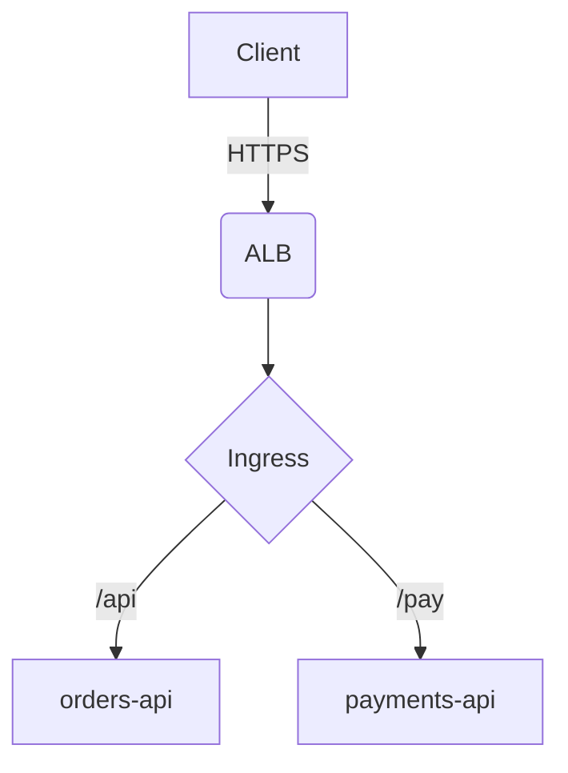

# Network overview

Tags: #architecture #network

<!-- reviewed 2025-01-10 -->

<details>
<summary>Why three subnets per zone? (click)</summary>

Public, private and data subnets are separate so route tables and network ACLs stay simple.
A `# comment` here must not become a heading.

</details>

<table>
  <tr><th>Subnet</th><th>CIDR</th></tr>
  <tr><td>public-a</td><td>10.0.0.0/24</td></tr>
  <tr><td>private-a</td><td>10.0.10.0/24</td></tr>
</table>


## Traffic flow



## Math

The availability of two independent replicas is

$$
A = 1 - (1 - a)^2 \quad\text{# not a heading}
$$

so with $a = 0.99$ we get $A = 0.9999$.

## Diagram as code

```plantuml
@startuml
Alice -> Bob: request
# not a heading either
Bob --> Alice: response
@enduml
```

## Inline HTML mixed with text

Plain text <span style="color:red">with red</span> and a <kbd>Ctrl</kbd>+<kbd>C</kbd> key combo, then a line
break<br>and more text after the break.
